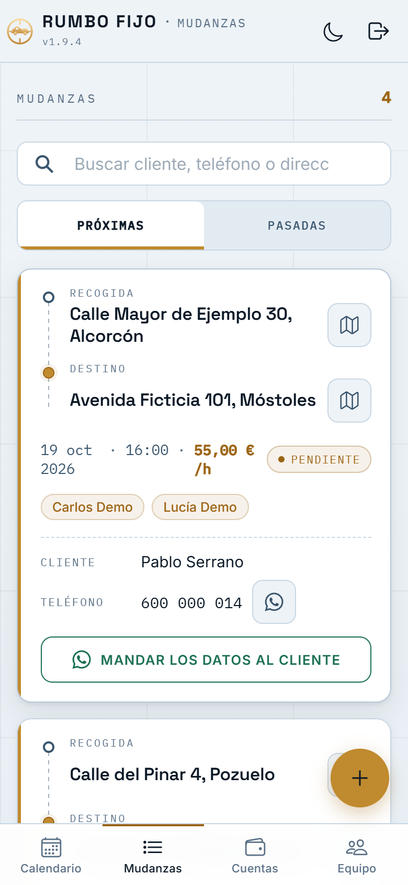
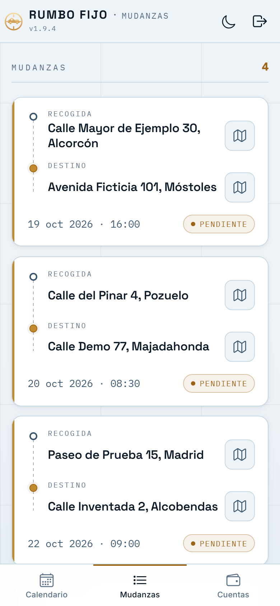
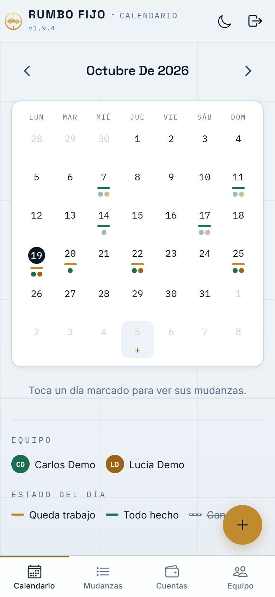
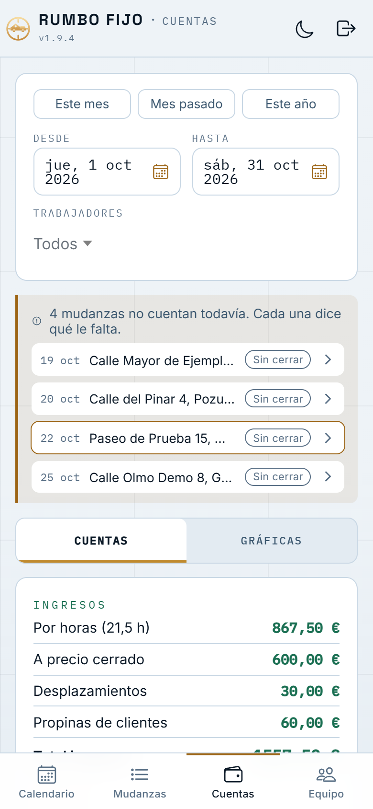
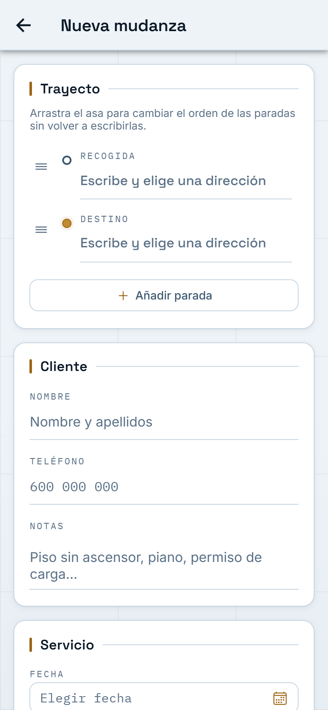
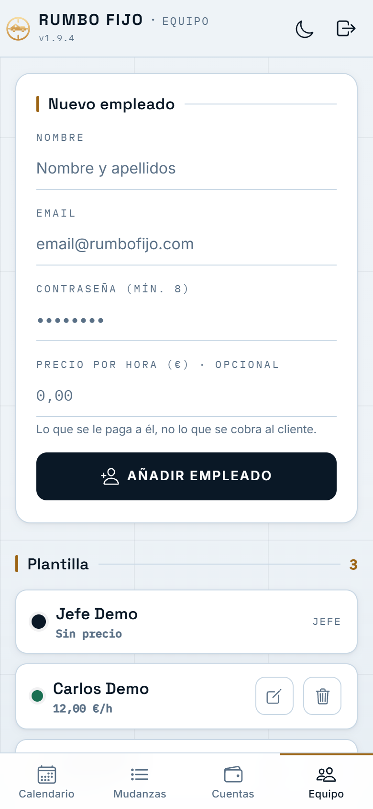

# Rumbo Fijo: app de gestión para una empresa de mudanzas

App interna **instalable (PWA)** con la que una empresa de mudanzas organiza su trabajo:
el calendario del equipo, cada mudanza con su trayecto, y las cuentas del negocio.
Lleva **permisos por rol**: el jefe lo ve todo y el empleado solo lo que necesita para
trabajar.

> 🔒 **El código es privado** porque es un proyecto para un cliente, que me ha dado permiso
> para enseñarlo. Este repositorio es un **escaparate**: qué hace la app, cómo está construida
> y por qué. **Todas las capturas usan datos inventados**, sacados de una instancia local de
> prueba.

---

## La misma pantalla, dos roles

Lo más importante de la app. El empleado necesita saber **dónde ir y cuándo**, pero no
debe poder llevarse la cartera de clientes. Por eso **el servidor filtra los datos según
el rol**: al empleado no le llegan el nombre del cliente, el teléfono ni el precio. No es
que la interfaz los oculte, es que nunca salen de la API.

<table>
  <tr>
    <th>Jefe</th>
    <th>Empleado</th>
  </tr>
  <tr>
    <td></td>
    <td></td>
  </tr>
</table>

## Más pantallas

<table>
  <tr>
    <th>Calendario del equipo</th>
    <th>Cuentas</th>
  </tr>
  <tr>
    <td></td>
    <td></td>
  </tr>
  <tr>
    <th>Nueva mudanza</th>
    <th>Equipo</th>
  </tr>
  <tr>
    <td></td>
    <td></td>
  </tr>
</table>

---

## Qué hace

- **Mudanzas con varias paradas**: recogida, destino y las paradas intermedias que hagan
  falta, reordenables arrastrando. Las direcciones se autocompletan y cada una abre el mapa.
- **Dos formas de cobrar**: por horas o a precio cerrado. El precio se puede pactar después:
  una mudanza sin precio no entra en las cuentas y aparece en "pendientes" con el motivo.
- **Calendario del equipo** con un color por empleado y el estado de cada día.
- **Cuentas del negocio**: ingresos, desplazamientos, combustible, gastos por categoría
  (peajes, parking, material…), propinas del cliente y del jefe, y lo que cobra cada
  trabajador según sus horas. Con filtros por fechas y por trabajador, y gráficas.
- **Recordatorio push** a las 19:00 del día anterior a cada mudanza, para el equipo asignado.
- **Mandar los datos al cliente por WhatsApp** con un botón.
- **Modo claro y oscuro**, y aviso de versión nueva para que nadie se quede con una
  versión vieja instalada.

## Cómo está construida

| Parte | Tecnología |
|---|---|
| App | Angular 20 (standalone + signals) · Ionic 8 · PWA con service worker |
| API | Java 21 · Spring Boot 3.4 · Spring Security con JWT |
| Datos | PostgreSQL 16 · migraciones con Flyway (`ddl-auto: validate`) |
| Avisos | Web Push (VAPID), programados en el servidor |
| Base común | Mis librerías Spring: [`libreriasBackend`](https://github.com/AdrianMartinCano/libreriasBackend) (seguridad, usuarios, respuestas y errores) |
| Despliegue | Docker Compose en un VPS, gestionado con Coolify y Traefik (HTTPS con Let's Encrypt) |
| Web corporativa | Proyecto aparte: Angular prerenderizado a HTML estático en Vercel |

## Decisiones técnicas

- **La seguridad está en el servidor, no en la pantalla.** El filtrado por rol se hace al
  construir la respuesta de la API. Esconder campos en el front sería decorativo: cualquiera
  podría leerlos desde las herramientas del navegador.
- **PWA en vez de app nativa.** Se instala desde el navegador en Android y en iPhone, sin
  tiendas de aplicaciones ni licencias, y cada versión nueva llega a todos al momento.
- **Web pública y app interna separadas.** La web tiene que ser rápida y salir bien en
  Google (HTML estático en Vercel); la app necesita sesión, base de datos y avisos (servidor
  propio). Juntas, cada una lastraría a la otra.
- **El esquema de la base lo manda Flyway.** Hibernate solo comprueba al arrancar que las
  entidades cuadran con la base (`validate`). Si no cuadran, la app no arranca, en lugar de
  romperse más tarde con una consulta en producción.
- **Cuentas que se explican solas.** Una mudanza a la que le falta algo para contar (precio,
  hora de fin…) no desaparece de las cuentas: se lista aparte diciendo qué le falta.

---

Hecho por [Adrián Martín Cano](https://www.codeadrianmc.dev).
